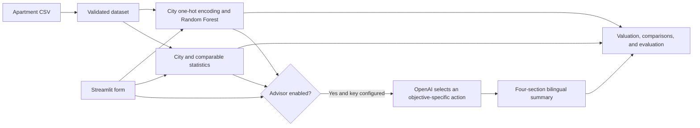

# AI Apartment Price Predictor

A Streamlit app for estimating apartment prices in USD and comparing the estimate with similar apartments in a bundled dataset. The project demonstrates a reproducible Random Forest regression workflow and offers an optional OpenAI property advisor in English and Arabic.

## Objectives and features

- Estimate a price and price per square meter from city, area, number of rooms, and floor.
- Compare the estimate with city and dataset averages, matching apartments, and an optional asking price.
- Explore comparable prices in a chart and a table, with summary statistics and a clear empty state.
- Inspect held-out model evaluation metrics in the app.
- Get a short, objective-specific advisor response for buying, selling, investing, or general valuation when the OpenAI advisor is enabled.

## Technology and architecture

Python 3.12, Streamlit, pandas, NumPy, scikit-learn, OpenAI Responses API, and python-dotenv. The interface uses HTML, CSS, and SVG for its light architectural theme.



## Dataset

The bundled `apartment_prices.csv` contains 150 apartment records. City counts are Gaza (43), Ramallah (42), Hebron (34), and Nablus (31).

| Column | Use |
| --- | --- |
| `apartment_id` | Unique row identifier, excluded from training |
| `city` | Categorical predictor |
| `area_sqm` | Apartment area, 75–219 m² |
| `rooms` | Room count, 2–6 |
| `floor` | Floor number, 1–10 |
| `price_usd` | Regression target, $64,800–$191,900 |

Comparable rows match the selected city and room count and have areas within ±20% of the entered area, inclusive. The table sorts them by absolute area difference. Average price per square meter is the mean of the individual price-to-area ratios.

The supplied files identify neither a data provider nor dates, collection methods, licensing, or whether the prices are listings or transactions. Confirm provenance and redistribution rights before making the repository public. Treat the records as a project sample.

## Machine learning

The app uses an 80/20 train/test split with random seed 42. The scikit-learn pipeline fits a one-hot encoder on training cities, passes the three numerical features through, and trains a 100-tree `RandomForestRegressor` with the same seed. The fitted pipeline is shared by evaluation and inference.

### Holdout evaluation

The model was trained on 120 rows and evaluated on 30 held-out rows. Reproduce the metrics with `python valuation.py` from the activated environment.

| Metric | Held-out result |
| --- | ---: |
| R² | 0.934485 |
| MAE | $5,447.23 |
| RMSE | $6,708.74 |

R² measures model fit on the test split. MAE is the average absolute test error, and RMSE gives larger errors more weight. These figures summarize a single split and do not provide apartment-level confidence or prediction intervals.

## Installation and usage

From the repository root on Windows PowerShell:

```powershell
python -m venv .venv
.\.venv\Scripts\python.exe -m pip install -r requirements.txt
.\.venv\Scripts\python.exe -m streamlit run app.py
```

On macOS or Linux:

```bash
python3.12 -m venv .venv
.venv/bin/python -m pip install -r requirements.txt
.venv/bin/python -m streamlit run app.py
```

Enter the apartment details, optionally enter an asking price, and select **Analyze Property**. The core valuation runs locally with no API key.

### Optional OpenAI advisor

Use an existing `OPENAI_API_KEY` process environment variable, or copy `.env.example` to `.env` and set the key there. Process environment values take precedence. Keep `.env` private and use your host’s secret store if deploying the app.

Set `OPENAI_MODEL` to override the default, [`gpt-5.4-mini`](https://developers.openai.com/api/docs/models/gpt-5.4-mini). Your API project needs access to a model that supports Responses and structured outputs. In the form, choose your objective and language, then enable **Generate AI Recommendations** before submitting.

The app sends property inputs, the estimate, and aggregate dataset statistics to OpenAI with response storage disabled. OpenAI selects from a set of objective-specific next steps. The app renders exactly four short sections and supplies every displayed figure from its own calculations. API errors leave the valuation, comparison, and metrics available.

## Project structure

```text
.
├── .streamlit/
│   └── config.toml
├── .env.example
├── .gitignore
├── README.md
├── advisor.py
├── apartment_prices.csv
├── app.py
├── architecture.svg
├── requirements.txt
├── tests/
│   └── test_project.py
└── valuation.py
```

`.env` and `.venv/` are local-only.

## Validation

With the environment activated, run:

```bash
python -m pip check
python -m unittest discover -s tests -v
python valuation.py
```

The tests cover model parity, dataset validation, encoding, comparables, advisor output and failures, and Streamlit form submissions. All advisor calls in the test suite are mocked.

## Security and limitations

Keep credentials out of code, notebooks, documentation, and Git history. API messages shown in the UI avoid raw SDK error details. In any public deployment, restrict access to the advisor or apply usage controls to protect the server-side API quota.

The model uses a small, undated sample across four cities. It cannot account for factors such as exact neighborhood, amenities, condition, legal status, or market changes. The dataset comparisons describe only the supplied records. A single random test split does not establish how the model performs on future sales.

The app is a portfolio demonstration for informational use. Seek independent, current market evidence and a qualified valuation for transaction decisions.
